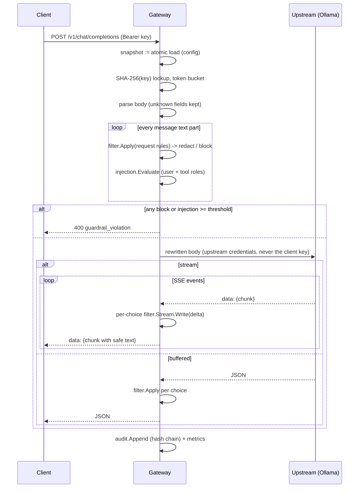

# Architecture

This document covers the request lifecycle, the detector contract, the
chunk-boundary-exact streaming algorithm (with a correctness sketch and
complexity), and the supporting subsystems.

## 1. Request lifecycle



One `filter.Namer` is shared by the request and the response of an exchange,
so a value redacted in the prompt keeps the same placeholder if it appears in
the reply.

## 2. Detector contract

Every detector (`internal/detect`) satisfies:

1. **Bounded length.** A match is at most `MaxLen` bytes.
2. **Declared alphabet.** Every byte of a match is in `InAlphabet`. Bytes that
   the accept function reads *past* the match end (for example the separator
   in `123-45-6789-0`) are added to the alphabet with the `lookahead` option.
3. **Local decisions.** Whether a candidate starting at `s` is accepted, and
   where it ends, depends only on `text[s-LeftContext : j+1]`. Here `j` is the
   first byte at or after `s` outside the alphabet, or `s+MaxLen+1`, whichever
   comes first.
4. **Deterministic leftmost scan.** `FindFrom(text, from)` returns the
   smallest accepted start `>= from` and its end.

For regular-expression detectors, (1) and (2) are not hand-maintained.
`AnalyzePattern` parses the pattern with `regexp/syntax` and walks the tree:

- the maximum width is the sum over concatenations, the max over
  alternations, and `max × child` for `{n,m}`. `*`, `+` and `{n,}` are
  rejected (`ErrUnboundedPattern`);
- the alphabet is the union of literal runes (with case folding) and character
  classes;
- the first-byte set computes nullable prefixes, so `(?:\+1)?[0-9]` starts
  with `+` or a digit.

Zero-width assertions (`^ $ \b \B`) are rejected (`ErrAnchoredPattern`).
Boundaries are checked in Go with explicit left context, so a scan resumed in
the middle of a text gives the same answer as a scan from the start. A test
checks every shipped detector against the contract.

**Scanning.** `patternDetector.FindFrom` walks start positions. It skips any
byte that is not in the first-byte set and any start that fails a cheap
left-boundary precheck (for example "not inside a digit run"). For the e-mail
detector it also jumps ahead to `next '@' - MaxLen`. It then runs the pattern
compiled as `^(?:expr)` on `text[s:]`. An anchored regexp gives the same
leftmost-first match at `s` that an unanchored search would report there, so
the semantics stay "leftmost accepted match". These prefilters made whole-text
filtering about 16× faster on the benchmark text (6.5 ms → 0.39 ms when
introduced).

Non-regex detectors implement the same contract directly:

- **High-entropy tokens.** Candidates are maximal runs of `[A-Za-z0-9+/_-]`,
  20 to 512 bytes long. A run is scored by Shannon entropy
  `H = −Σ p·log₂p` over its bytes and by its character-class mix. Pure-hex
  runs (commit SHAs, UUIDs) need a credential keyword nearby. A keyword lowers
  the threshold from 4.0 to 3.0 bits per byte.
- **Credential assignments.** The detector scans for `:` and `=`, checks
  that the preceding key (up to a quote and 3 spaces) ends in a credential
  name, and reports only the value: 6 to 64 bytes and at least two character
  classes. Values longer than 64 bytes are not reported. Truncating them would
  leak the remainder.

**Overlaps.** Findings from different detectors are merged into clusters (their
union span). The cluster's action is the strongest member action
(`block > redact > log`). Its label is the member with that action and the
highest priority (vendor keys 95 > JWT 90 > credential 85 > entropy 80 > card
70 > IBAN 68 > national IDs 65 > e-mail 60 > phone 50).

## 3. Chunk-boundary-exact streaming

**Goal.** For any split of a text `T` into chunks, the concatenated output of
`Stream.Write(c₁) … Write(cₙ); Close()` must equal `Apply(T)`: the same bytes,
the same findings with the same offsets, and the same block decision.

**State.** For each detector `d`, `pos_d` is an absolute scan position. The
stream also keeps the unreleased text `buf` (plus `LeftContext` bytes of
already-emitted text), the absolute offset `emitted`, and the committed but
unreleased findings `pending`.

**Open region.** After a write, let `L = len(buf)` (absolute). For detector `d`:

```
T_d = start of the maximal suffix of buf made only of d-alphabet bytes
U_d = max(T_d, L − (MaxLen_d + 2))      // 2 = lookahead slack
```

**Lemma 1.** Any candidate starting at `s < U_d` is decided the same way in
`buf` as in the full text.
*Sketch.* If `s < T_d`, a non-alphabet byte `j` lies in `[s, L)`. A match from
`s` cannot cross `j`, and by contract (3) the decision reads at most up to `j`.
If `s ≤ L − MaxLen − 2`, the match and its lookahead lie entirely in `buf`.
Prefixes are identical, and the patterns have no end anchors, so the regexp's
preferred match at `s` is identical too.

**Commit rule.** Run `FindFrom` from `pos_d`. Commit each result whose start is
`< U_d` and continue from its end. Stop at the first result whose start is
`≥ U_d`, or when there is none. Then set `pos_d = max(pos_d, U_d)`.

**Lemma 2.** The committed findings are exactly the full-text findings of `d`
that start before `pos_d`.
*Sketch.* By Lemma 1, every start position tried below `U_d` gets the same
accept/reject decision as it would in the full text, so the sequence of
results matches the full-text scan up to `U_d`. When the scan stops, no
accepted start lies in `[from, U_d)`. Hence `FindFrom(full, from) =
FindFrom(full, U_d)`, and resuming at `U_d` loses nothing.

**Release rule.** `F = min_d pos_d`, or the end of text on `Close`. Every
finding starting before `F` is known. Clusters are formed from `pending`. If a
cluster straddles `F`, the cut moves back to the cluster start, so a later
finding cannot extend a cluster that was already released. The cut then
moves back to a UTF-8 rune boundary. Text up to the cut is rendered. A
`block` cluster emits only the text before it and ends the stream.

**Theorem.** The output equals the whole-text oracle for every chunking.
Lemma 2 makes the findings identical, and the release rule never emits text
whose cluster membership could still change. Placeholder numbering follows
emission order, which is the same order as the oracle's. The property test
(`TestChunkBoundaryProperty`, 1,500 cases including byte-at-a-time splits)
and the fuzz target compare against a naive full-text implementation.
`make mutation` shows that weakening either margin breaks the test.

**Latency.** The hold-back is `L − F`. For prose it is the current partial
word: no detector alphabet spans a space except phone numbers (digits and
separators) and IBANs (uppercase, digits, spaces). `TestStreamingLatencyOnProse`
pins this. A long unbroken token (a base64 blob) is held until it ends or
exceeds the largest `MaxLen` (4 KB in the worst case, the JWT bound).

**Complexity.** Per write, each detector runs `openStart` in `O(MaxLen)` worst
case (`O(trailing run)` typically) and scans `[pos_d, L)`. That region is the
new chunk plus at most the open tail, because the scan is skipped entirely
while `U_d ≤ pos_d`. Each scanned position costs `O(1)` for the prefilter and
`O(MaxLen)` for an anchored regexp attempt, so total work is
`O((n + k·MaxLen)·D)` for `n` bytes in `k` chunks across `D` detectors.
Memory is `O(LeftContext + hold-back + pending findings)` per stream,
independent of response length. On the benchmark text (2.7 KB, dense with
digits and secrets), whole-text filtering takes 0.35 ms and 4-byte streaming
0.64 ms (`BenchmarkApply`, `BenchmarkStream4`).

## 4. SSE proxy

`internal/sse.Reader` implements the WHATWG event-stream parser. It accepts LF,
CRLF and CR terminators, a lone CR followed by LF split across reads, comment
lines and multi-line `data:`. Events are bounded at 1 MiB, and an
unterminated trailing event is discarded per the spec.

The gateway keeps one `filter.Stream` per `choices[].index` and does the
following for each upstream chunk:

- passes chunks without content through: role deltas, `usage`-only chunks and
  upstream `error` events;
- rewrites `delta.content` with the safe text and drops chunks that end up
  with nothing to say;
- on `finish_reason`, closes that choice's filter and appends the flushed text;
- on a block, emits the safe prefix with `finish_reason: content_filter`. When
  every choice is blocked it sends `[DONE]` and cancels the upstream request;
- on `[DONE]` or upstream EOF, flushes any open filters in one synthetic chunk;
- drops events that are not JSON, because what cannot be inspected is never
  relayed.

Writes are flushed only when the SSE reader has no buffered upstream bytes.
Bursts coalesce, and no event waits behind an upstream read.

## 5. Configuration and hot reload

`config.Parse` decodes YAML strictly (unknown keys are errors), applies
defaults and validates everything. It reports all errors at once, joined.
`Compile` builds an immutable `Compiled` snapshot: the detector set, policy
profiles, and a key table indexed by `SHA-256(api key)`. The watcher polls
the file hash every `reload.interval` and on `SIGHUP`. A changed and valid
file is swapped in with `atomic.Pointer.Swap`. An invalid one is logged,
counted (`gw_config_reloads_total{result="rejected"}`) and ignored. `listen`
and `audit.path` are bound at startup, and a warning is logged if they change.

## 6. Audit log

Each line is a JSON object ending in `"hash":"<sha256>"`. The hash covers the
line's bytes without that member, and the object carries `prev`, the
previous line's hash. Verification recomputes the hashes and checks
`prev`/`seq` continuity, which detects edits, deletions, reordering and
truncation of the hash member. `audit.Open` verifies an existing file before
appending and refuses to fork a broken chain. Sensitive values appear only as
`HMAC-SHA256(key, kind ‖ 0 ‖ value)` truncated to 96 bits. The HMAC key comes
from `audit.hmac_key_env`. Without one, a random per-process key is used and
the logs say so.

## 7. Rate limiting

There is one token bucket per key name, with capacity `burst` and refill
`requests_per_minute/60` per second. Buckets refill lazily on access, so cost
is O(1) per request and zero for idle keys. After a reload, a bucket is
clamped to the new burst on its next use. Buckets of removed keys are dropped.
`429` responses carry `Retry-After`, and every response carries
`X-RateLimit-Limit` and `X-RateLimit-Remaining`.

## 8. Injection scorer

`normalize` lowercases the text, folds full-width ASCII and common
Cyrillic/Greek homoglyphs, strips zero-width characters (and counts them),
joins runs of four or more single letters separated by single spaces
("i g n o r e"), and collapses whitespace. A de-leeted view
(`0→o 1→i 3→e 4→a 5→s 7→t @→a $→s`) is also matched. Each of the ten rules
has trigger substrings, and its regexp runs only when a trigger is present
(`TestTriggersAreNecessary` guards this). The score is
`1 − exp(−Σ weights / 2)`. Obfuscation signals (zero-width, spaced letters,
leet) only add weight when another signal fired, or on their own for
zero-width characters. The default threshold of 0.70 had the best F1 on the
dev split. One override-style phrase (weight 3.0) reaches 0.78. A lone
persona phrase (weight 0.8) stays at 0.33.
